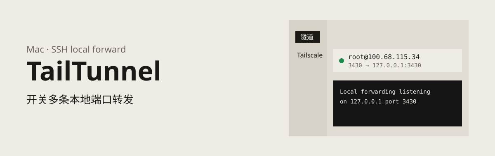
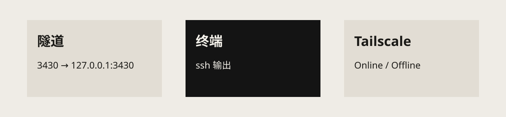

<p align="center">
  
</p>

<p align="center">
  <a href="./LICENSE"></a>
  
  
</p>

TailTunnel 是一个 macOS 桌面应用，用于管理 SSH 本地端口转发（`ssh -L`）。它在同一个窗口中集中配置、启停和监控多条隧道，并显示每条隧道的 `ssh` 输出。

TailTunnel 调用系统自带的 OpenSSH，不自行实现 SSH 协议。

## 目录

- [特性](#特性)
- [工作原理](#工作原理)
- [界面](#界面)
- [安装](#安装)
- [快速开始](#快速开始)
- [配置](#配置)
- [项目结构](#项目结构)
- [参与贡献](#参与贡献)
- [许可证与致谢](#许可证与致谢)

## 特性

- **多条隧道，独立控制**：每条隧道对应一次 `ssh -L`，可单独启动或停止；一条隧道可包含多个本地端口转发。
- **可靠的状态判断**：隧道有「已停止」「正在连接」「运行中」「连接失败」四种状态。只有在 SSH 实际开始监听端口后才会显示为「运行中」，而不是在命令发出时。
- **SSH 跳板**：一条隧道可以选择「经跳板连接」，通过一台跳板机再连到目标主机。跳板与目标主机各自使用独立的用户和密码。
- **延迟对比**：点击隧道行上的计时器按钮，测量直连目标的延迟；配置了跳板时，同时测量经跳板的延迟，并给出哪条线路更快。
- **日志面板**：选中隧道后，在列表下方查看其 `ssh` 输出，支持复制和导出为 JSON。
- **快速访问**：点击列表中的本地端口，即用浏览器打开对应的 `localhost` 地址。
- **后台运行与菜单栏**：关闭窗口后隧道继续运行，应用保留在 Dock 和菜单栏中。菜单栏图标旁显示运行中的隧道数，可直接启停隧道或重新打开窗口。
- **Tailscale 视图**：列出 Tailscale 网络中的设备及其地址，并标明在线设备是直连还是经由 DERP 中继。
- **进程清理**：退出应用时，本次启动的 SSH 子进程会一并终止；下次启动不会依据旧的进程号去结束其他进程。

## 工作原理

一条隧道由一个远程主机和若干本地转发组成，对应一次 `ssh -L` 调用：同一次 SSH 连接上可以同时承载多条本地端口转发。

<p align="center">
  
</p>

SSH 端口仅在编辑隧道时填写，不显示在列表中。备注为可选项：填写后，窗口和菜单栏显示备注，否则显示「用户@主机」。

### 经跳板连接

在编辑隧道时勾选「经跳板连接」并填写跳板的主机、端口、用户和密码，SSH 会先登录跳板，再由跳板连接目标主机：

```text
本机 ──▶ 跳板 ──▶ 目标主机
```

- 跳板与目标主机使用各自的用户和密码。
- 底层使用 `-o ProxyCommand='ssh -W %h:%p …'`，其效果等同于 `ssh -J`，并让跳板这一跳带上与目标连接相同的选项（主机密钥策略、仅密码认证等）。
- 配置了跳板的隧道，目标主机只能包含字母、数字和 `. - _ : %`。
- 适合直连线路绕路或受限、而跳板所在网络到目标更好的场景。

### 延迟对比

点击隧道行上的计时器按钮，测量 5 次并在该行下方显示结果：

| 项目 | 含义 |
| --- | --- |
| 直连 | 本机到目标 SSH 端口：从发起 TCP 连接到收到 SSH 横幅的时间。 |
| 本机→跳板 | 本机到跳板 SSH 端口的 TCP 握手时间，仅作参考。 |
| 经跳板 | 通过跳板上的一条复用连接，开通道到目标并收到 SSH 横幅的时间，已扣除本机启动 `ssh` 进程的开销。 |

对比直连与经跳板的平均值，显示哪条线路更快。

> [!NOTE]
> 这是基于 TCP 的往返时延，不是 ICMP ping，也不是带宽测试：延迟低不代表传输速度快。起进程的开销按 `ssh -O check` 估算，经跳板的数值可能比真实值高几毫秒，差距只有几毫秒时不宜据此判断。

## 界面

应用包含三个页面：

| 页面 | 说明 |
| --- | --- |
| **隧道** | 隧道列表与终端面板，用于创建、启停隧道并查看输出。 |
| **Tailscale** | 列出 Tailscale 网络中的设备和地址（可复制）。在线设备标明连接方式（直连或 DERP 中继），当前设备标记为「本机」。未安装 Tailscale 时，该页仅提示未检测到，不提供安装。 |
| **设置** | 显示配置文件路径，可切换到其他 JSON 文件。 |

## 安装

目前仅在 macOS 上开发和测试，尚未提供预编译安装包，需从源码构建。

**前置依赖**

- [Node.js](https://nodejs.org/) 与 npm
- [Rust](https://www.rust-lang.org/tools/install) 工具链
- OpenSSH（macOS 自带）
- [Tauri 2 的系统依赖](https://tauri.app/start/prerequisites/)

**获取源码并运行**

```bash
git clone https://github.com/colojayce/TailTunnel.git
cd TailTunnel
npm install
npm run tauri dev
```

**构建发布版本**

```bash
npm run tauri build
```

## 快速开始

1. 启动应用，在「隧道」页点击「新建」。
2. 填写主机、SSH 端口、用户、密码，并添加一个或多个本地转发（本地端口、远程主机、远程端口）。需要经跳板时，勾选「经跳板连接」并填写跳板信息。
3. 保存后点击「启动」。状态变为「运行中」后，即可通过 `localhost:<本地端口>` 访问远程服务。
4. 选中隧道，在底部终端面板中查看 `ssh` 输出。

## 配置

隧道配置（包括目标主机和跳板的 SSH 密码）以明文保存在本机的一个 JSON 文件中，默认路径为：

```text
~/Library/Application Support/com.tailtunnel.app/tunnels.json
```

> [!WARNING]
> 该文件包含 SSH 密码（含跳板密码）。请勿将其提交到版本库或与他人共享。

配置文件路径可在「设置」页中更改。

## 项目结构

TailTunnel 是一个 [Tauri 2](https://tauri.app/) 应用：Rust 后端负责 SSH 子进程、配置文件和 Tailscale 状态，前端使用 TypeScript 和 Vite。

```text
.
├── src/                 # 前端界面（TypeScript、CSS、图标字体）
├── src-tauri/
│   └── src/
│       ├── lib.rs       # Tauri 命令与应用入口
│       ├── latency.rs   # 直连与经跳板的延迟测量
│       ├── manager.rs   # SSH 子进程的启停与状态管理
│       ├── model.rs     # 数据模型、配置读写与 ssh 参数生成（含跳板）
│       └── tailscale.rs # 读取 Tailscale 状态
├── assets/              # README 使用的图片
└── public/              # 静态资源
```

## 参与贡献

欢迎通过 [Issues](https://github.com/colojayce/TailTunnel/issues) 反馈问题或提出建议，也欢迎提交 Pull Request。提交前请确保 `npm run build` 能够通过。

## 许可证与致谢

本项目基于 [MIT 许可证](./LICENSE) 发布。

- 界面图标来自 [Remix Icon](https://remixicon.com)，字体文件随仓库放在 `src/fonts/`，适用 [Remix Icon License v1.0](./src/fonts/Remix-Icon-License.txt)。
- 界面字体使用 [IBM Plex](https://github.com/IBM/plex)（通过 [Fontsource](https://fontsource.org/) 引入）。
